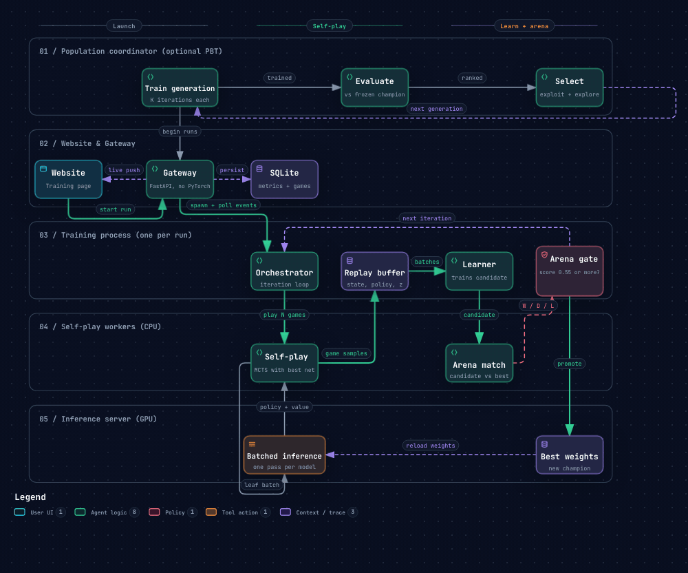

# Chess RL

A chess engine that learns by playing against itself. You create a neural network, let it play thousands of games with Monte-Carlo tree search, train it on those games, and keep a new version only when it beats the previous one in a head-to-head match. Everything is controlled from a web interface: play against your models, watch them play each other, start and monitor training, compare versions and tune every setting.



> Interactive version of this diagram (hover, trace routes, export): [`docs/chess-rl-workflow.html`](docs/chess-rl-workflow.html). Source: [`docs/chess-rl-workflow.json`](docs/chess-rl-workflow.json), generated with [Archify](https://github.com/tt-a1i/archify).

## Contents

- [Features](#features)
- [Quick start](#quick-start)
- [How training works](#how-training-works)
- [Process architecture](#process-architecture)
- [The neural network](#the-neural-network)
- [Tree search (MCTS)](#tree-search-mcts)
- [Settings reference](#settings-reference)
- [Population training](#population-training)
- [The website](#the-website)
- [Data and storage](#data-and-storage)
- [API and WebSocket channels](#api-and-websocket-channels)
- [Environment variables](#environment-variables)
- [Tests and benchmarks](#tests-and-benchmarks)
- [Project structure](#project-structure)
- [Regenerating the workflow diagram](#regenerating-the-workflow-diagram)

## Features

- **Self-play training loop**: self-play, learning and an arena gate repeat until you stop them or a set number of iterations is reached.
- **Arena gate**: a freshly trained candidate replaces the best network only when it scores at least the configured threshold against it (default 0.55). Elo is updated from the match score.
- **Batched inference**: self-play workers send the positions they want evaluated to one inference server, which groups them into large batches so the GPU stays busy.
- **Several models at once**: each model trains in its own process; capacity limits are computed from your RAM, cores and VRAM.
- **Population Based Training**: train a group of agents, rank them against a frozen champion, keep the best and replace the rest with slightly mutated copies.
- **Web interface**: play, spectate, train, manage models, inspect the architecture, change settings. English and Arabic interface.
- **Crash-tolerant runtime**: engine workers are supervised and restarted with backoff; checkpoints and buffers are written atomically; the training state survives a closed server.
- **CPU or GPU**: the launcher detects your hardware, picks the right PyTorch build and suggests a network size that fits.

## Quick start

```bash
python run.py             # guided: libraries, device + network selection, website build, launch
python run.py --auto      # skip the questions and use the recommended choices
```

`run.py` does four steps every time:

1. **Libraries**: creates two virtual environments (a light *gateway* one and a heavy *engine* one with PyTorch) and installs what is missing.
2. **Selection**: asks for the device (CPU or GPU) and the default network size, using terminal screens.
3. **Prepare**: installs the PyTorch build that matches your device, creates the checkpoint folder and builds the website. Node.js is downloaded automatically if it is missing, and is used only for the build.
4. **Launch**: starts the gateway, which serves the website and starts the engine workers. The browser opens at `http://127.0.0.1:8000/`.

| Option | Effect |
|---|---|
| `--auto` | Use the recommended choices, no questions (or set `CHESSRL_AUTO=1`) |
| `--no-train` | Play and spectate only, training features are disabled |
| `--no-frontend` | Do not build the website (the API still works, docs at `/docs`) |
| `--no-browser` | Do not open the browser |

To change host or port: `CHESSRL_HOST=0.0.0.0 CHESSRL_PORT=9000 python run.py`.

## How training works

One **iteration** of a training run (`backend/rl/orchestrator.py`):

1. **Self-play with the best network.** `games_per_iteration` games are played with MCTS. For every move, the visit counts of the search become the policy target `π`; when a game ends, its result becomes the value target `z` for every position in it. All samples go into the replay buffer.
2. **Learning.** Once the buffer holds at least `min_buffer` positions, a learner trains a *candidate* network (a copy of the best) on batches sampled from the buffer. The loss is `(z − v)² − π · log p` with weight decay in the optimizer. On CUDA, mixed precision is used (bfloat16 when supported, otherwise float16 with a loss scaler).
3. **Arena gate.** The candidate plays `arena_games` games against the best network. If its score is at least `arena_threshold`, it is **promoted**: its weights become the new best network, Elo goes up by the rating difference implied by the match score, and the inference server reloads the weights. Otherwise the best network stays and training continues from the candidate.
4. **Repeat.** Metrics (policy loss, value loss, Elo, games per minute, buffer size, arena result) are published as numbered events. The gateway polls them twice a second, stores them in SQLite and pushes them to the website.

Things worth knowing:

- Games longer than `max_plies` are adjudicated as draws.
- Finished games are replaced immediately by new ones, so GPU batches stay full.
- Pausing a run stops the loop and the workers; pause time is not counted as work in the games-per-minute figures.
- The replay buffer is saved next to the model (`.buffer.npz`) and reloaded when the run restarts.
- A **learner gate** (lock files) limits how many learners train at the same moment across all training processes, because two learners on one GPU only fight for it and each needs its own weights, gradients and optimizer state in VRAM.

## Process architecture

| Process | Where | What it does |
|---|---|---|
| **Gateway** | `backend/app/` | FastAPI server: REST + WebSocket + the website. No PyTorch, starts in about a second. Stores everything in SQLite, runs the population coordinator, supervises the engine workers. |
| **Training process** (one per run) | `backend/rl/orchestrator.py` | The iteration loop, replay buffer, learner and arena gate. Keeps a numbered event log that the gateway polls. |
| **Self-play workers** | `backend/rl/selfplay_workers.py` | CPU only, no PyTorch (about 0.2 GB each). Play self-play and arena games with MCTS and ask the inference server for evaluations. |
| **Inference server** | `backend/inference/` | Owns the networks and the device. Collects requests from every worker, flushes a model's batch when it is full, when its oldest request waited `max_wait_ms`, or when every client is already waiting, then runs one forward pass. Batches are per model. |

Engine workers listen on a free `127.0.0.1` port and only answer requests that carry the secret token generated for the current run. A worker moves through `STARTING → READY → CRASHED → BACKOFF → STARTING …`, with at most 5 restarts before it is marked `FAILED`.

`backend/capacity.py` turns your hardware into limits: how many models may train at once, how many self-play workers each gets, and whether a shared inference server is worth it (it needs at least 3 cores).

## The neural network

A residual convolutional network with two heads (`backend/rl/network.py`).

```
Input (18 x 8 x 8)
  -> Conv3x3 + BatchNorm + ReLU
  -> N x Residual block (Conv3x3 + BN + ReLU + Conv3x3 + BN, skip connection, ReLU)
       |- Policy head: Conv1x1 (32) -> BN -> ReLU -> Flatten -> FC(4672)
       '- Value head : Conv1x1 (1)  -> BN -> ReLU -> FC(256) -> ReLU -> FC(1) -> Tanh
```

**Input planes** (always from the point of view of the side to move; for Black the board is flipped vertically, so the network never learns two colours separately):

| Planes | Meaning |
|---|---|
| 0-5 | My pieces: P N B R Q K |
| 6-11 | Their pieces |
| 12 | Colour (1 = White to move) |
| 13-14 | My castling rights (king side, queen side) |
| 15-16 | Their castling rights |
| 17 | En-passant square |

**Output**: 4672 move logits = 64 squares × 73 move planes (56 queen-like slides including queen promotions, 8 knight jumps, 9 under-promotions).

**Presets** (any blocks × filters combination is also possible; blocks 1-40, filters 16-512):

| Preset | Blocks | Filters | Parameters | Size (fp32) | Recommended VRAM |
|---|---|---|---|---|---|
| Tiny | 3 | 64 | ~9.8 M | ~37 MB | CPU is fine |
| Small | 6 | 128 | ~11.4 M | ~43 MB | 2 GB |
| Medium | 10 | 192 | ~16.3 M | ~62 MB | 6 GB |

Most parameters sit in the policy head's fully connected layer, which is why small networks are still around 10 M parameters.

## Tree search (MCTS)

PUCT search built for batched evaluation (`backend/rl/mcts.py`). A search job never calls the network itself: it hands out the positions it wants evaluated and takes the answers back, so the leaves of many games can be mixed into one batch. A single game can also send several leaves at once using virtual loss. Dirichlet noise is added at the root during self-play, moves are sampled with a temperature for the first plies and played greedily afterwards, and the search tree can be reused between moves.

## Settings reference

All tuning knobs live on the website's **Settings** page, not on the command line. Defaults and allowed ranges:

**Tree search**

| Setting | Default | Range |
|---|---|---|
| `simulations` per move | 100 | 50 - 800 |
| `c_puct` | 1.5 | 0.1 - 10 |
| `dirichlet_alpha` | 0.3 | 0.01 - 2 |
| `dirichlet_eps` (0 disables root noise) | 0.25 | 0 - 1 |
| `temperature` | 1.0 | 0 - 5 |
| `temperature_moves` | 20 | 0 - 200 |
| `leaves_per_batch` | 8 | 1 - 64 |
| `max_plies` | 400 | 40 - 1000 |

**Training**

| Setting | Default | Range |
|---|---|---|
| `lr` | 1e-3 | 1e-6 - 1 |
| `weight_decay` | 1e-4 | 0 - 0.1 |
| `batch_size` | 256 | 8 - 4096 |
| `games_per_iteration` | 50 | 1 - 5000 |
| `epochs_per_iteration` | 1 | 1 - 50 |
| `max_steps_per_iteration` | 400 | 1 - 100000 |
| `buffer_size` | 200 000 | 1 000 - 5 000 000 |
| `min_buffer` | 2 000 | 0 - 1 000 000 |
| `concurrent_games` (per self-play process) | 32 | 1 - 512 |
| `arena_games` | 20 | 2 - 400 |
| `arena_simulations` | 100 | 10 - 800 |
| `arena_threshold` | 0.55 | 0.5 - 1.0 |

**Machine** (chosen by `run.py`, stored in `data/runtime/selection.json`): device, default network, number of self-play workers, maximum parallel runs, shared inference server on/off, `max_batch` and `max_wait_ms`, CPU threads for a CPU server, and the maximum number of simultaneous learners.

## Population training

Population Based Training trains many agents of one model side by side (`backend/app/coordinator.py`, `backend/rl/population.py`). Generation after generation:

1. **Training**: every agent trains `iterations_per_generation` more iterations as its own run.
2. **Evaluating**: every agent plays the same frozen champion. Score is win = 1, draw = 0.5, loss = 0. Ties are broken by the lower total training loss (policy + value).
3. **Selecting**: the strongest `survivor_fraction` of agents stay (exploit). The others are replaced by copies of survivors, taken in turn best first, whose hyper-parameters are nudged (explore): each of `simulations`, `c_puct`, `temperature`, `dirichlet_eps` and `lr` is multiplied by `1 ± mutation_strength` and clamped to the allowed range. Children can also copy their parent's replay buffer.

| Setting | Default | Range |
|---|---|---|
| `size` (agents) | 10 | 2 - 100 |
| `survivor_fraction` | 0.25 | 0.05 - 0.5 |
| `iterations_per_generation` | 3 | 1 - 1000 |
| `mutation_strength` | 0.2 | 0 - 0.5 |
| `copy_buffer` | true | |

The population row stores its `generation` and `phase`, so a stopped coordinator, or a server closed in the middle, continues from the same point: agents that already trained enough are skipped, a scored generation is not scored again and an existing next generation is not recreated.

## The website

| Page | What you can do |
|---|---|
| **Play** | Play against any model or hot-seat. Choose your colour, undo, ask for a hint, resign, export the game as PGN, and see what the model sees. |
| **Spectate** | Start a match between two models, change its speed, watch the board with live evaluation, move list, thinking and clocks. |
| **Training** | Start, pause, resume and stop runs for single models (or all models at once), follow live self-play, losses, Elo, games per minute and arena results. A second view manages populations. |
| **Models** | Create, rename, clone, download and delete models, bulk delete, download all, and open a model's architecture. |
| **Architecture** | Visual tower of the network: residual blocks feeding the policy and value heads. |
| **Settings** | Network, tree search, training, interface (board theme, piece set, arrows, evaluation, language) and device. |

The interface is available in English and Arabic.

## Data and storage

Everything lives under `data/` (override with `CHESSRL_DATA_DIR`):

| Path | Contents |
|---|---|
| `data/runtime/chess_rl.db` | SQLite: models, training runs, per-iteration metrics, arena matches, games (PGN), user settings, populations and their members |
| `data/runtime/selection.json` | Device and machine choices made by `run.py` |
| `data/runtime/venv/` | The `gateway` and `engine` virtual environments |
| `data/runtime/logs/` | Process logs |
| `data/checkpoints/` | Model weights, candidate weights and replay buffers |

## API and WebSocket channels

Interactive documentation is served at `/docs` while the gateway runs. Main groups:

| Prefix | Purpose |
|---|---|
| `/api/games` | New game, play a move, undo, resign, hint, PGN, history |
| `/api/models` | List, create, rename, clone, delete, bulk delete, download, download all, architecture |
| `/api/training` | Start, start all, pause/resume/stop, watch a run, status, runs and their metrics, inference server status |
| `/api/populations` | List, create, inspect, start, stop, delete |
| `/api/arena` | Start a match, read it, change its speed, cancel |
| `/api/settings` | Read, update and reset settings |
| `/api/system` | Engine status, capacity estimate, restart a worker |

WebSocket channels: `/ws/training`, `/ws/population`, `/ws/game/{id}`, `/ws/match/{id}`, `/ws/system`.

## Environment variables

| Variable | Meaning |
|---|---|
| `CHESSRL_HOST`, `CHESSRL_PORT` | Where the gateway listens (default `127.0.0.1:8000`) |
| `CHESSRL_AUTO` | `1` = same as `--auto` |
| `CHESSRL_DATA_DIR` | Move the whole `data/` folder |
| `CHESSRL_ENGINE_PYTHON` | Use a specific interpreter for the engine workers |
| `CHESSRL_FAKE_ENGINE` | `1` = real chess and real MCTS but no network and synthetic losses, so the whole pipeline runs without PyTorch (used by the tests) |
| `CHESSRL_NODE_MIRROR` | Alternative to `https://nodejs.org/dist` for the Node.js download |

## Tests and benchmarks

The backend tests run with the fake engine, so they do not need PyTorch (the two files that need it skip themselves when it is missing):

```bash
pip install fastapi httpx uvicorn chess numpy pytest
pytest tests
```

They cover the RL core, the inference server and transport, remote self-play, the training scope, metrics persistence, bulk model operations, stress runs and every phase of the population feature.

Benchmarks in `tools/`:

```bash
python tools/bench.py --runs 1,2,4 --seconds 20 [--evaluator uniform|torch] [--device cpu|cuda]
python tools/bench_pipeline.py --latency-ms 6 --games 24
```

`bench.py` measures games per minute, positions per second, average batch size and the share of time spent inside the network, for N independent self-play processes. `bench_pipeline.py` compares one blocking connection against two pipelined connections to see whether overlapping CPU work with the network wait helps. Saved results are in `data/bench_*.json`.

## Project structure

```
run.py                  launcher (4 steps: libraries, selection, prepare, launch)
backend/
  app/                  gateway: main, api/*, ws, services, state, population coordinator
  rl/                   mcts, network, encoding, selfplay, selfplay_workers, trainer,
                        orchestrator, arena, gate, replay_buffer, population, config
  inference/            inference server, transport, client, sources
  cli/                  terminal screens and dependency installer (select, ui, deps, node)
  runtime.py            starts, watches and restarts engine workers
  db.py                 SQLite schema and queries
  capacity.py           how much this machine can run at once
  hardware.py           RAM, cores, GPU and CUDA detection
  settings.py           defaults, limits and validation
frontend/               React + Vite website (pages, components, i18n)
tests/                  backend tests (fake engine)
tools/                  benchmarks
docs/                   workflow diagram (GIF, interactive HTML, JSON source)
```

## Regenerating the workflow diagram

The diagram is generated with [Archify](https://github.com/tt-a1i/archify) from `docs/chess-rl-workflow.json`:

```bash
git clone https://github.com/tt-a1i/archify.git
node archify/archify/bin/archify.mjs finalize workflow docs/chess-rl-workflow.json docs/chess-rl-workflow.html --quality showcase
```

The GIF is the diagram's *Live* motion captured frame by frame at 25 fps with the animation clock frozen, so every frame is evenly spaced and the loop closes without a jump.
